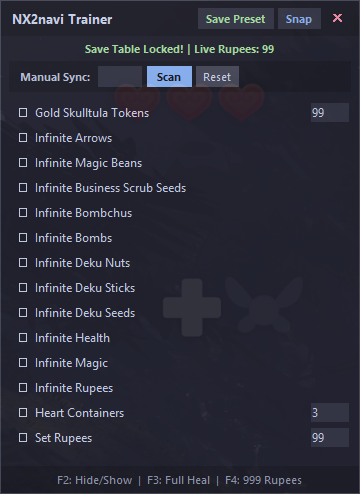

# NX2navi Trainer

A lightweight, borderless transparent HUD trainer and real-time memory overlay for **NX2navi** (`ocarina.exe`), *The Legend of Zelda: Ocarina of Time* static recompilation for Windows.



## Features

- **Instant Save-Table Auto-Lock:** Automatically locates the 40-byte save table and player health structures in `ocarina.exe` on startup without requiring external configuration files.
- **Borderless Transparent Overlay:** Semi-transparent (`0.90` alpha) dark HUD that automatically snaps to the top-left corner of the `ocarina.exe` game window (with drag support).
- **Global In-Game Hotkeys:**
  - `F2` — Hide / Show the HUD overlay
  - `F3` — Instant Full Heal
  - `F4` — Instant 999 Rupees
- **Custom Presets (`Save Preset`):** Save your favorite active toggles and custom values (such as Heart Containers or Gold Skulltula Tokens) to `nx2navi_preset.json` for automatic loading on next launch.
- **Included Cheats:**
  - Infinite Health & Custom Heart Containers (`1`–`20` hearts)
  - Infinite Magic
  - Infinite Rupees (`999`) & Set Custom Rupees
  - Infinite Arrows, Bombs, Bombchus, Deku Seeds, Deku Sticks, Deku Nuts, Magic Beans, and Business Scrub Seeds
  - Gold Skulltula Tokens modifier
- **Manual Rupee Sync Fallback:** Built-in value scanner in case a future update shifts memory layouts.

## Quick Start

### Option 1: Run the Prebuilt Executable (Recommended for Players)
1. Download the latest release from the [Releases](../../releases) page.
2. Start **NX2navi** (`ocarina.exe`) and load into an active savegame.
3. Run `NX2navi_HUD_Trainer.exe` (or double-click `Launch_NX2navi_Trainer.bat` to launch both automatically).

### Option 2: Run from Python Source
1. Install Python 3.10+ for Windows.
2. Install the required dependencies:
   ```bash
   pip install -r requirements.txt
   ```
3. Load into a savegame in `ocarina.exe`, then run:
   ```bash
   python NX2navi_Trainer.py
   ```

### Building a Standalone `.exe` Yourself
Run `Build_Standalone_EXE.bat` in the project directory. It installs `PyInstaller` and outputs `NX2navi_Trainer.exe` inside the `dist/` folder.

## Disclaimer

This project is intended for single-player experimentation and convenience. Back up your save files before modifying memory values.
